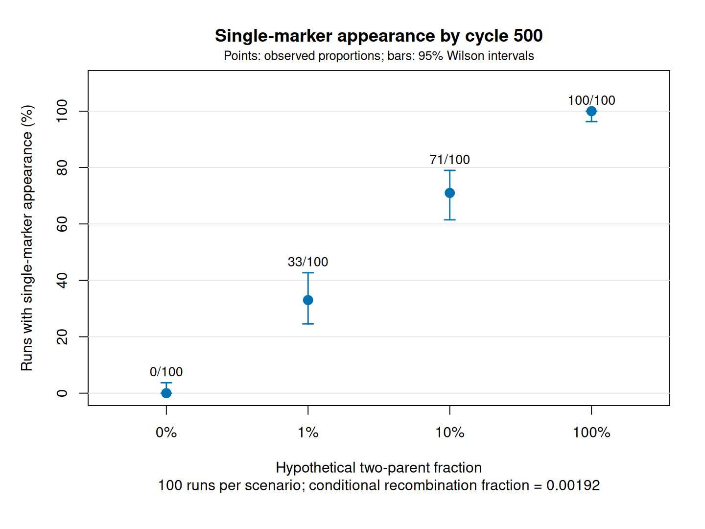

# Azole-resistance persistence in Aspergillus fumigatus

An educational population-genetics project built with **SLiM 5.2 and R**,
exploring how selection, genetic drift, environmental dispersal, and
two-marker inheritance affect an existing resistance genotype.

The project develops from a clonal resistance-persistence model into
two environmental patches, separate TR34 and L98H markers, and a neutral
model with optional two-parent inheritance.

**Current scope:** selection and dispersal are explored in clonal models;
recombination is explored separately under neutrality. These processes
have not yet been combined into a complete fungal life-cycle model.

## Featured experiment: separating linked markers

How does the frequency of two-parent reproduction affect the appearance
of single-marker genotypes when both markers initially occur together?



In 100 runs per scenario, single-marker genotypes appeared in **0, 33,
71 and 100 runs** as the hypothetical two-parent fraction increased
from 0% to 1%, 10% and 100%.

All genotypes had equal fitness. The conditional recombination fraction
was held at 0.00192, based on a cross-specific literature estimate.
Two-parent fractions are sensitivity scenarios, not measured natural
sexual frequencies. Appearance at least once does not imply persistence
to the endpoint.

[Explore the neutral model, results and figures](docs/neutral_two_markers.md)

## Models and questions

| Component | Question | Implementation and checks |
|---|---|---|
| Clonal persistence: scripts 07–09 | How do exposure duration and post-withdrawal cost affect persistence? | 500 haploids; 100 runs per scenario |
| Environmental dispersal: script 10 | Can resistance reach and persist in an unexposed patch? | Two patches; 300 validated trajectories |
| Separate markers: script 11 | Does splitting TR34 and L98H preserve clonal behaviour? | 300 trajectories matched the combined-marker model |
| Inheritance checks: scripts 12–13 | Does the implementation transmit and recombine markers as intended? | Controlled crosses and a 100,000-offspring stochastic check |
| Neutral inheritance: script 14 | How does two-parent reproduction affect marker separation? | 400 validated trajectories across four hypothetical fractions |

TR34 and L98H are represented as inherited markers. The models do not
literally insert promoter sequence or substitute nucleotides.

## Selected findings

- **Persistence after withdrawal:** with withdrawal at cycle 50,
  resistance remained at cycle 500 in 76%, 14% and 0% of runs under
  illustrative post-withdrawal costs of 0%, 1% and 5%, respectively.
- **Environmental dispersal:** resistance reached the initially
  susceptible patch in 99/100 runs at 0.1% dispersal and 100/100 runs
  at 1% dispersal. Arrival did not guarantee endpoint persistence.
- **Marker inheritance:** separating the markers preserved the clonal
  model's trajectories. Enabling recombinant inheritance allowed
  single-marker genotypes to appear without new mutation.

These are simulation outcomes under stated assumptions, not estimates
of resistance prevalence or natural sexual reproduction frequency.

### Resistance frequency after withdrawal


Clonal baseline: exposure ends at cycle 50. Curves show mean resistance
frequency across 100 runs per scenario, including losses and fixation.
Zero cost is the baseline; 1% and 5% costs are hypothetical.
Mean frequency is different from the proportion of runs retaining resistance.

## Explore the results

- [Clonal baseline: assumptions, results and reproduction commands](docs/baseline_persistence.md)
- [Two-patch dispersal: arrival and persistence](docs/two_population_dispersal.md)
- [Controlled and stochastic inheritance checks](docs/inheritance_checks.md)
- [Neutral two-marker experiment: results and figures](docs/neutral_two_markers.md)

## Quick start

Requirements: **SLiM 5.2**, **R**, and Bash for the runners.
Analysis uses base R; the neutral plotting script uses Cairo PDF output.

Clone the repository and run commands from its root:

```bash
git clone https://github.com/alexandranagybio/azole-resistance-persistence.git
cd azole-resistance-persistence
```

### Explore the saved neutral experiment

```bash
Rscript analysis/analyse_neutral_two_markers.R
Rscript analysis/plot_neutral_two_markers.R
```

The analysis checks all 400 trajectories and writes summaries to
`data/summaries/neutral_two_markers_100/`.
Figures are saved as PNG and PDF in `figures/neutral_two_markers_100/`.
Rerunning these commands replaces the corresponding derived outputs.

### Run one neutral simulation

With `slim` on PATH:

```bash
mkdir -p data/example

slim -s 1001 \
  -d SEXUAL_FRAC=0.1 \
  -d RECOMB_FRAC=0.00192 \
  -d 'OUTFILE="data/example/neutral_seed_1001.csv"' \
  models/14_neutral_two_marker_population.slim
```

Replace `slim` with your executable path if needed. Script 14 refuses
an existing output file; choose a fresh OUTFILE for another run.

### Regenerate the neutral experiment

```bash
SLIM_BIN="$HOME/SLiM/build/slim" \
  bash scripts/run_neutral_two_markers.sh data/reproduced_neutral_two_markers
```

The runner executes 400 simulations, records parameters and seeds in
a manifest, and refuses an existing destination.

The neutral analysis and plotting scripts currently read the saved
original experiment paths. They do not automatically analyse an
alternate runner destination.

## Reproducibility and validation

- Explicit seeds and parameters are recorded for the experiments.
- Validation checks cycle records, population sizes, frequency bounds,
  initial conditions, and relevant inheritance constraints.
- All 180 original baseline trajectories were reproduced exactly
  within the larger baseline experiment.
- All 300 two-patch trajectories were regenerated and matched their
  original CSV values exactly.
- All 300 separate-marker clonal trajectories matched the
  combined-marker model's resistance frequencies.
- All 400 neutral trajectories passed validation.
- Software versions are recorded in [software_versions.txt](software_versions.txt).

Trajectory validation and reproducibility assess implementation.
They do not establish that the biological assumptions are correct.
The 400-run neutral experiment has been validated but has not yet
undergone a separate complete regeneration comparison.

## Assumptions and limits

- Population sizes, selection coefficients, and dispersal rates are
  illustrative.
- Zero post-withdrawal cost is the baseline; positive costs are
  hypothetical sensitivity scenarios.
- No new mutations occur in these models.
- A reproductive cycle is not a calendar day.
- Marker coordinates are abstract.
- Two-parent inheritance does not explicitly model mating types,
  tetrads, or the complete fungal life cycle.
- The neutral model's recombination fraction is cross-specific;
  transfer to other genetic backgrounds is an assumption.
- Confidence intervals describe Monte Carlo uncertainty within a
  scenario, not uncertainty in biological parameters.

## Biological references

- Mellado et al. (2007): TR34/L98H resistance mechanism.
  https://doi.org/10.1128/AAC.01092-06
- *Variability in competitive fitness among environmental and clinical
  azole-resistant Aspergillus fumigatus isolates* (2024).
  https://doi.org/10.1128/mbio.00263-24
- Rhodes et al. (2022): environmental and clinical population genomics.
  https://doi.org/10.1038/s41564-022-01091-2
- Lofgren et al. (2022): population structure and recombination.
  https://doi.org/10.1371/journal.pbio.3001890
- Auxier et al. (2023): meiotic crossovers and two-marker recombination.
  https://doi.org/10.1371/journal.pbio.3002278

## Repository layout

| Folder | Contents |
|---|---|
| `models/` | SLiM models and inheritance checks |
| `scripts/` | Simulation runners |
| `analysis/` | R validation, summaries and plotting |
| `data/` | Saved trajectories, manifests and summaries |
| `figures/` | PNG and PDF figures |
| `docs/` | Detailed model explanations and results |
| `archive/` | Earlier scripts retained as learning history |

## Author and license

Alexandra Nagy.

MIT License. Copyright (c) 2026 Alexandra Nagy. See [LICENSE](LICENSE).