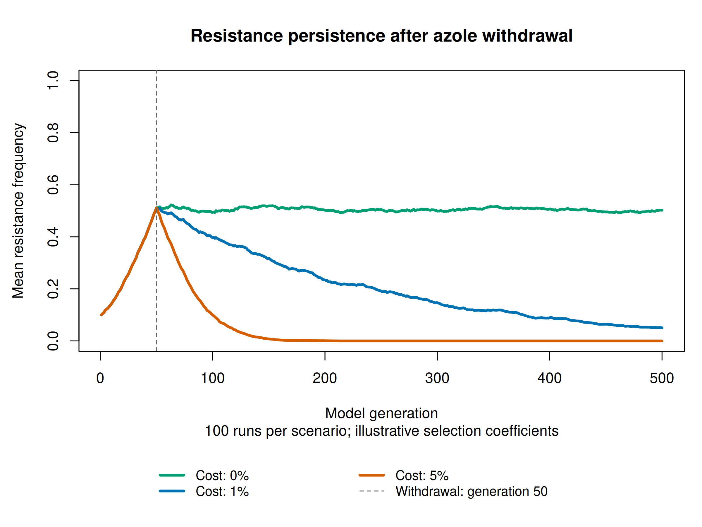
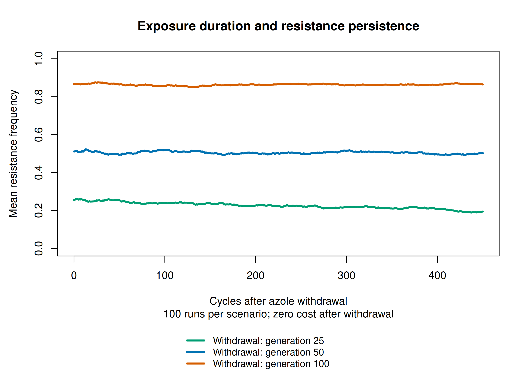
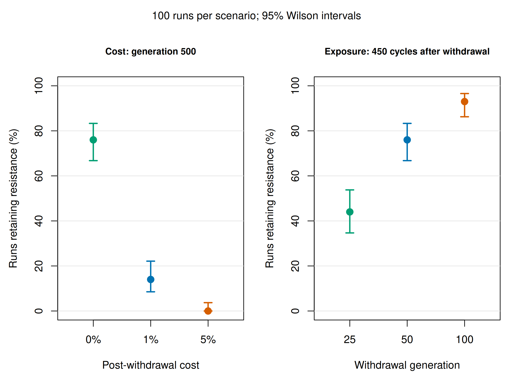

# Azole-resistance persistence in Aspergillus fumigatus

An educational SLiM 5.2 project exploring how selection, genetic drift,
and exposure duration affect the persistence of an existing resistance
genotype after azole withdrawal.

## Model

The population contains 500 clonal haploid individuals, initially including
50 resistant individuals (resistance frequency 0.1).

One inherited mutation marker represents the complete cyp51A TR34/L98H
genotype. The promoter tandem repeat and amino-acid substitution are not
modelled separately. The chromosome length and marker position are abstract.

During exposure, the resistance marker has an illustrative selection
coefficient of +0.05. Selection changes to -COST at withdrawal.

Resistance is introduced at the end of generation 1. Selection changes at the
end of the withdrawal generation, affecting reproduction from the following
cycle onward.

- Zero cost is the baseline.
- Costs of 1% and 5% are hypothetical sensitivity scenarios.
- There are no new mutations, migration, or recombination.
- Population size remains constant.
- A model generation is a reproductive cycle, not a calendar day.

The model examines persistence of standing resistance; it does not simulate
the origin of resistance or predict resistance prevalence in natural populations.

## Biological motivation

The 2024 study *Variability in competitive fitness among environmental and
clinical azole-resistant Aspergillus fumigatus isolates* reported no detectable
fitness cost for engineered cyp51A mutants under its tested conditions.

Competitive fitness varied among the sampled resistant isolates. The study’s
genetic manipulation experiments indicated that fitness costs were not directly
attributable to the cyp51A resistance mutations alone. We therefore use zero cost
as an educational baseline and explore hypothetical positive costs as sensitivity
scenarios.

These findings do not establish that resistance is cost-free in every genetic
background or environment.

References:

- TR34/L98H resistance mechanism:
  https://doi.org/10.1128/AAC.01092-06
- Competitive fitness study:
  https://doi.org/10.1128/mbio.00263-24
- Population structure and recombination: Lofgren et al. (2022),
  *The pan-genome of Aspergillus fumigatus provides a high-resolution view of its
  population structure revealing high levels of lineage-specific diversity driven
  by recombination*. https://doi.org/10.1371/journal.pbio.3001890

## Clonal baseline and recombination

Clonal reproduction is a deliberate simplifying assumption of this baseline.
Lofgren et al. (2022) analysed 260 genomes and reported extensive recombination
within three primary populations of A. fumigatus, with recombination occurring
only rarely between those populations. Although dispersal occurs primarily via
asexual conidia, the species' population history therefore cannot be represented
fully by an exclusively clonal model.

The genomic evidence reflects recombination accumulated over evolutionary
history. It does not directly specify the fraction of sexual reproduction or a
per-cycle recombination rate for our simulation. Those parameters would need
additional justification for a defined ecological setting.

Our results describe persistence in a closed, clonal population under the stated
selection assumptions. They do not yet account for sexual exchange, population
structure, or linkage between resistance and other fitness-related variants.
The single marker represents the entire TR34/L98H genotype, so recombination
cannot separate its promoter and coding components in the current model.

A future extension could introduce occasional sexual reproduction and explicit
linked variants: separate promoter and L98H states, plus genetic-background
variants affecting fitness. This would allow us to investigate whether resistance
remains associated with advantageous or costly backgrounds. Genome-wide evidence
of recombination does not establish how often the nearby promoter and coding
alterations are separated; their distance and local recombination behaviour matter.

Increasing the recombination-rate setting alone while retaining entirely clonal
reproduction would not implement genetic exchange between parents. A reproductive
mechanism permitting exchange and explicit genomic variation would be required.
Population structure and migration could then be introduced in later versions.
These are proposed extensions; the current simulations and reported results
remain the clonal baseline.

## Experiments and results

The main experiment uses seeds 1001–1100 (100 runs per scenario).
Persistence means that at least one resistant individual remains at the endpoint.
Both segregating and fixed outcomes count as persistence.

### Cost after withdrawal at generation 50

| Post-withdrawal cost | Persistence at generation 100 | Persistence at generation 500 | 95% Wilson interval at 500 | Lost / segregating / fixed at 500 | Mean frequency at 500 |
|---|---:|---:|---|---|---:|
| 0% | 98% | 76% | 66.8–83.3% | 24 / 52 / 24 | 0.50222 |
| 1% | 97% | 14% | 8.5–22.1% | 86 / 12 / 2 | 0.05016 |
| 5% | 88% | 0% | 0–3.7% | 100 / 0 / 0 | 0.00000 |



### Exposure duration at zero cost

All scenarios have a follow-up of 450 reproductive cycles after withdrawal.

| Withdrawal generation | Final generation | Mean frequency at withdrawal | Endpoint persistence | 95% Wilson interval | Lost / segregating / fixed | Mean final frequency |
|---|---:|---:|---:|---|---|---:|
| 25 | 475 | 0.25606 | 44% | 34.7–53.8% | 56 / 41 / 3 | 0.19462 |
| 50 | 500 | 0.51120 | 76% | 66.8–83.3% | 24 / 52 / 24 | 0.50222 |
| 100 | 550 | 0.86770 | 93% | 86.3–96.6% | 7 / 16 / 77 | 0.86460 |





Under these settings, longer exposure raises resistance frequency before
withdrawal and is associated with greater endpoint persistence.

At zero cost, resistance can still be lost through genetic drift.
At fixation, a fitness cost alone cannot restore susceptible individuals:
the model has no mutation or migration to reintroduce them.

Wilson intervals describe Monte Carlo uncertainty in the proportion of runs
retaining resistance under the specified model. They do not capture uncertainty
in biological parameters or establish real-world prevalence. Observing no
persistence in 100 runs does not establish a zero persistence probability.
The intervals are calculated separately for each scenario; they are not intervals
for differences between scenarios.

### Earlier 20-run learning milestone

The original seeds 1001–1020 and their figures and summaries are preserved.
These seeds are also the first 20 seeds of the larger experiment, so the two
experiments are not independent samples.

| Scenario | Persistence with 20 runs | Persistence with 100 runs |
|---|---:|---:|
| Cost 0%, generation 500 | 75% | 76% |
| Cost 1%, generation 500 | 30% | 14% |
| Cost 5%, generation 500 | 0% | 0% |
| Withdrawal 25, 450-cycle follow-up | 45% | 44% |
| Withdrawal 50, 450-cycle follow-up | 75% | 76% |
| Withdrawal 100, 450-cycle follow-up | 95% | 93% |

The change in the 1% cost estimate illustrates variability from a small number
of simulation replicates. All 180 original trajectories were reproduced exactly
within the 100-run experiment.

## Project contents

| Folder | Contents |
|---|---|
| `models/` | Short, extended, and exposure-duration SLiM models |
| `scripts/` | Sequential simulation runner with configurable replicate count |
| `analysis/` | Base R validation, summaries, confidence intervals, and figures |
| `data/raw/` | Original 20-run trajectories |
| `data/replicates_100/` | Main 100-run trajectories and logs |
| `data/summaries/` | Original and regenerated 20-run summaries |
| `data/summaries/replicates_100/` | Main 100-run summaries with Wilson intervals |
| `figures/` | Original 20-run PNG and PDF figures |
| `figures/replicates_100/` | Main 100-run PNG and PDF figures |
| `archive/` | Earlier scripts retained as learning history |

The 900 trajectories comprise nine sets of 100 runs. Short runs are prefixes
of their extended counterparts, and the zero-cost generation-500 experiment
also appears in the withdrawal-at-50 exposure scenario. These are reproducibility
comparisons, not additional independent replicates. Scenarios use matching seeds;
confidence intervals use the 100 outcomes within each scenario.

## Run a simulation

Requirements: SLiM 5.2 and R. Analysis uses base R.

Run commands from the repository root. Replace `slim` with the path to your
SLiM executable if it is not on PATH.

```bash
mkdir -p data/example

slim \
  -s 1001 \
  -d COST=0.0 \
  -d EXPOSURE_END=50 \
  -d 'OUTFILE="data/example/seed_1001.csv"' \
  models/09_TR34_L98H_exposure_duration.slim
```

All models default to `COST=0.0`.
Script 09 defaults to withdrawal at generation 50 and ends 450 cycles later.
It accepts integer withdrawal generations from 2 to 550.

Scripts 07 and 08 withdraw exposure at generation 50 and end at generations
100 and 500, respectively.

Supply a unique OUTFILE for every run. The default output is
`changing_exposure.csv` in the current working directory, which is replaced
when another run starts.

## Reproduce analysis and figures

Run from the repository root. For the main 100-run experiment:

```bash
Rscript analysis/analyse_results.R data/replicates_100 100 data/summaries/replicates_100
Rscript analysis/make_figures.R data/replicates_100 100 data/summaries/replicates_100
```

For the original 20-run experiment, use the defaults:

```bash
Rscript analysis/analyse_results.R
Rscript analysis/make_figures.R
```

The analysis accepts a data folder, replicate count, and summary output folder,
in that order. It checks generation ranges, frequency bounds, initial frequency,
agreement between short and extended runs, and matching trajectories before
withdrawal. For the larger experiment it also checks the original 180 trajectories.

Regenerated summaries use `recomputed_` filenames, preserving the original
summaries. Rerunning analysis replaces the corresponding regenerated summaries.
Figure outputs go to `figures/` for 20 runs and `figures/replicates_N/` otherwise,
where N is the replicate count. Rerunning figure generation replaces those exports.

Figure curves show means across all runs, including runs that lost resistance.
Mean resistance frequency and persistence are different measures: a mean near
0.5 does not mean that resistance persists in 50% of runs.

## Reproduce all simulations

The runner accepts an output folder and replicate count, in that order.
With SLiM on PATH, reproduce the 100-run experiment into a new destination:

```bash
bash scripts/run_experiments.sh data/reproduced_100 100
```

Alternatively, specify the executable:

```bash
SLIM_BIN="$HOME/SLiM/build/slim" bash scripts/run_experiments.sh data/reproduced_100 100
```

The runner executes 900 simulations sequentially and saves CSVs and logs.
It refuses to reuse an existing output folder. Use a new destination for each
reproduction run. Seeds start at 1001 and increase with the requested count.

Without arguments, it defaults to 20 runs per scenario (180 simulations),
saved under `data/reproduced/`:

```bash
bash scripts/run_experiments.sh
```

All 180 trajectories regenerated with the updated project models matched the
original CSVs exactly. The larger experiment passed trajectory validation and
reproduced those same 180 trajectories exactly.

## Two-patch dispersal extension

An extension explores resistance arrival and persistence between an
azole-exposed environmental patch and an unexposed patch, using 100
replicates at each of three clonal dispersal rates.

See the [model, results, figures and reproduction instructions](docs/two_population_dispersal.md).

## License

MIT License. Copyright (c) 2026 Alexandra Nagy. See [LICENSE](LICENSE).
