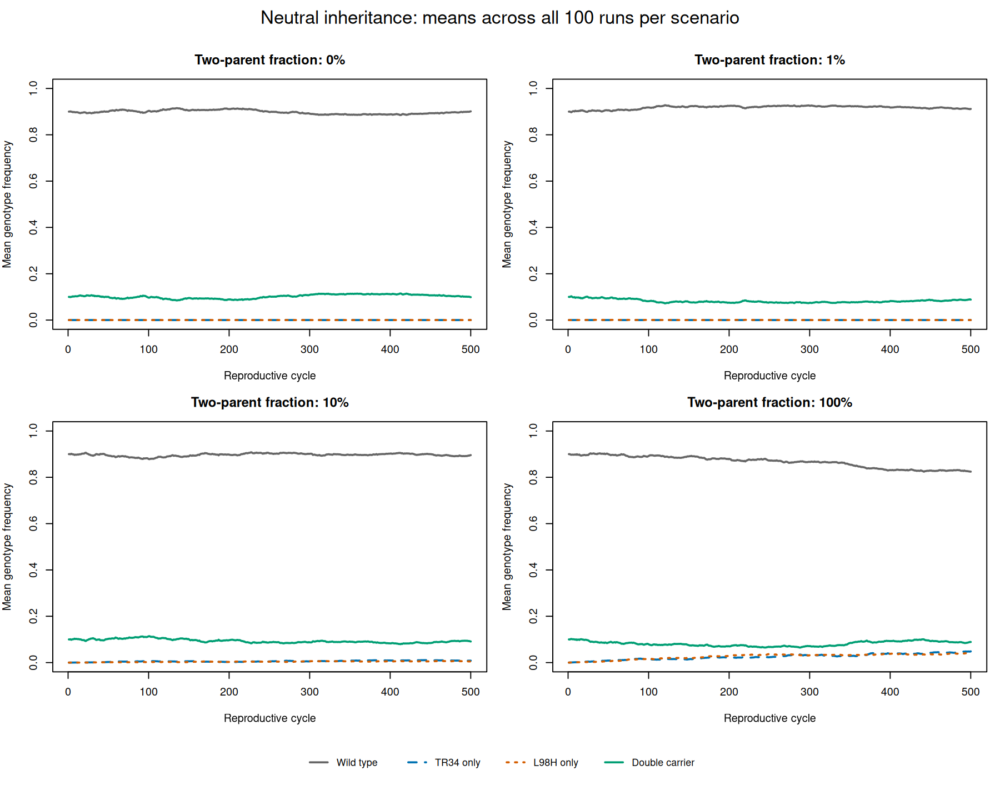

# Neutral two-marker population model

## Purpose

Script 14 checks clonal and two-parent inheritance in a population
before adding selection or dispersal.

## Model

- One population of 500 haploid individuals.
- Initially 450 wild type and 50 double-marker carriers.
- All four genotypes have equal fitness.
- No new mutation or migration.
- Cycle 1 records the founders.
- Cycles 2–500 each produce exactly 500 offspring.
- Parents die after reproduction; generations do not overlap.

SEXUAL_FRAC is the hypothetical probability of two-parent inheritance.
Otherwise, an offspring is a clone of one uniformly sampled parent.

Two-parent events sample two distinct individuals uniformly.
RECOMB_FRAC specifies the probability of recombinant inheritance
between the markers within such an event.

Mating types, tetrads, and the complete fungal sexual cycle are not
represented. Marker coordinates are abstract.

The default RECOMB_FRAC of 0.00192 follows the cross-specific total
recombinant fraction inferred by Auxier et al. (2023):
https://doi.org/10.1371/journal.pbio.3002278

It is not an estimate of how frequently sex occurs in nature.
Applying it to other parental backgrounds is a modelling assumption.

## Diagnostic runs

All three runs use seed 1001.

| Scenario | SEXUAL_FRAC | RECOMB_FRAC |
|---|---:|---:|
| Clonal | 0 | 0.00192 |
| Two-parent, no recombination | 1 | 0 |
| Two-parent, with recombination | 1 | 0.00192 |

These settings isolate inheritance mechanisms; they are not estimates
of natural reproductive behaviour.

Neither control produced single-marker genotypes.

With recombination, a TR34-only individual first appeared at cycle 4.
At that cycle there were 444 wild-type individuals, one TR34-only
individual, no L98H-only individuals, and 55 double carriers.

Both markers were lost by cycle 500 in all three diagnostic runs.
These single-run outcomes do not estimate loss probabilities.

Offspring are independent inheritance draws. Reciprocal recombinant
genotypes therefore need not appear together in the same cycle.

## Validation

The model checks population size, removal of older parents, genotype
frequency totals, and absence of single-marker genotypes in controls.

The saved R checker additionally checks all 500 cycle records,
initial conditions, frequency ranges and increments, marker-frequency
calculations, and absorbing loss and fixation of each marker.

Recombinant appearance is reported, not required for a run to pass.
A valid stochastic run can lose the markers before recombinants arise.

## Reproduce

Run from the project root. Output files must not already exist.

```bash
mkdir -p data/checks/neutral_two_markers

~/SLiM/build/slim -s 1001 \
  -d SEXUAL_FRAC=0.0 \
  -d RECOMB_FRAC=0.00192 \
  -d 'OUTFILE="data/checks/neutral_two_markers/clonal_seed_1001.csv"' \
  models/14_neutral_two_marker_population.slim

~/SLiM/build/slim -s 1001 \
  -d SEXUAL_FRAC=1.0 \
  -d RECOMB_FRAC=0.0 \
  -d 'OUTFILE="data/checks/neutral_two_markers/two_parent_no_recomb_seed_1001.csv"' \
  models/14_neutral_two_marker_population.slim

~/SLiM/build/slim -s 1001 \
  -d SEXUAL_FRAC=1.0 \
  -d RECOMB_FRAC=0.00192 \
  -d 'OUTFILE="data/checks/neutral_two_markers/two_parent_recomb_seed_1001.csv"' \
  models/14_neutral_two_marker_population.slim

Rscript analysis/check_neutral_two_markers.R
```

Generated diagnostic CSVs are ignored by Git.


## Replicated neutral experiment

We ran 100 simulations per hypothetical two-parent fraction, using
seeds 1001–1100 and a conditional recombination fraction of 0.00192.
All 400 trajectories passed validation.

| Two-parent fraction | Runs with single-marker appearance | 95% Wilson interval | Median first cycle among observed runs |
|---|---:|---:|---:|
| 0% | 0/100 | 0–3.70% | Not observed |
| 1% | 33/100 | 24.56–42.70% | 110 |
| 10% | 71/100 | 61.46–78.99% | 29 |
| 100% | 100/100 | 96.30–100% | 5 |

Appearance means presence at least once, not persistence to cycle 500.
Medians exclude runs without appearance. The clonal control cannot
produce single-marker genotypes under the model assumptions.

Higher hypothetical two-parent fractions increased observed marker
separation. These scenarios do not estimate natural sexual frequency.

At 100% two-parent reproduction, both markers persisted in 19 runs,
but double carriers persisted in 18. One run therefore retained both
markers exclusively in separate individuals.

All genotypes have equal fitness. Differences between scenario means
do not demonstrate a selective advantage.

Marker association is D = f_double - p_TR34 * p_L98H.
Loss or fixation of either marker also makes D zero, so declining D
alone does not demonstrate recombination.

### Figures

Points show appearance percentages; bars show 95% Wilson intervals.
The clonal interval summarises replicate counts, although absence
of marker separation is guaranteed by the model in that scenario.


Curves show mean genotype frequencies across all 100 runs, including
losses and fixation.



### Replicated workflow

Run scripts/run_neutral_two_markers.sh with Bash and SLIM_BIN pointing
to the SLiM executable. The default destination is
data/neutral_two_markers_100; an existing destination is refused.
The runner records parameters and seeds in manifest.csv.

Then run analysis/analyse_neutral_two_markers.R and
analysis/plot_neutral_two_markers.R with Rscript from the project root.
Both use the original experiment paths.

An optional runner argument selects a fresh output directory.
The analysis scripts do not automatically follow that alternate path.