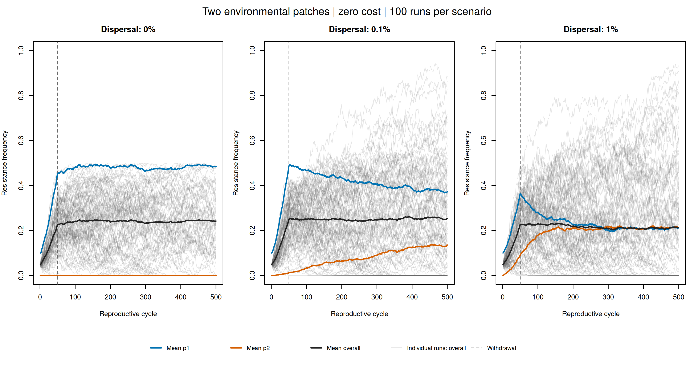
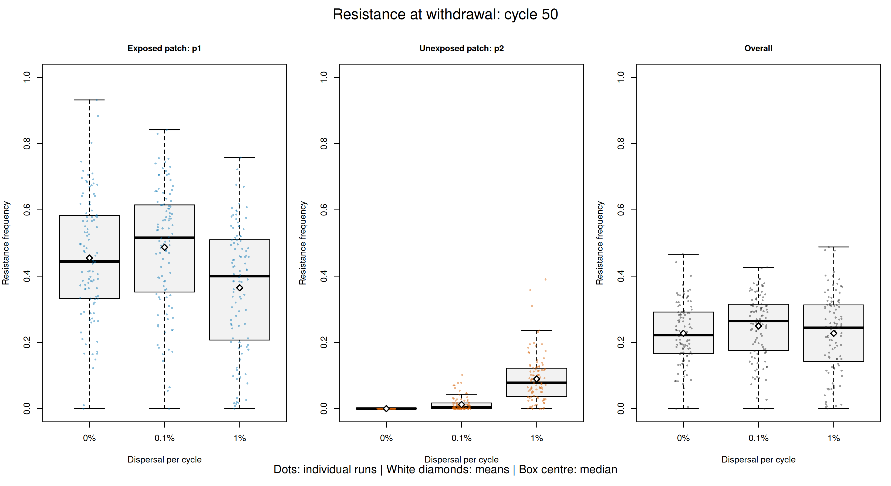

# Resistance persistence and dispersal between environmental patches

## Question

How does clonal dispersal between an azole-exposed environmental patch
and an unexposed patch affect TR34/L98H arrival and persistence?

## Biological motivation

Rhodes et al. (2022), "Population genomics confirms acquisition of
drug-resistant Aspergillus fumigatus infection by humans from the
environment", Nature Microbiology 7, 663–674, identified highly related
clinical and environmental isolates, population structure, and limited
recombination between major genetic clades.

This extension explores movement of resistance between environmental
patches. The patches do not represent the paper's genetic clades.
Human infection, genetic background diversity, and recombination are
not simulated. The study motivates the question; it does not supply
our numerical selection or dispersal parameters.

## Model

- Two patches, each containing 500 clonal haploid individuals.
- Initially 50 resistant individuals in p1 and none in p2.
- Initial resistance frequency: p1 = 0.1; p2 = 0; overall = 0.05.
- One inherited marker represents the complete TR34/L98H genotype.
- No new mutations or recombination.
- p1 exposure gives resistance an illustrative selection coefficient +0.05.
- p2 is never exposed.
- Exposure ends after reproduction at cycle 50.
- Unexposed cost is zero in this experiment.
- Simulation ends at cycle 500, 450 cycles after withdrawal.
- Cycles are reproductive cycles, not calendar days.

Symmetric dispersal rates are 0, 0.001 and 0.01 per cycle. In this
Wright–Fisher implementation, each rate specifies the probability
that an offspring in the destination patch derives from a parent
in the other patch. It represents successful clonal dispersal and
establishment, rather than all released or transported spores.

Each scenario uses 100 seeds, 1001–1100. Adding a second population
changes the random-number sequence, so matching seeds do not imply
identical trajectories to the original one-population model.

## Results

| Dispersal per cycle | Ever arrived in p2 | Persisted in p1 at cycle 500 | Persisted in p2 at cycle 500 | Persisted anywhere at cycle 500 |
|---|---:|---:|---:|---:|
| 0% | 0/100 | 74/100 | 0/100 | 74/100 |
| 0.1% | 99/100 | 74/100 | 68/100 | 75/100 |
| 1% | 100/100 | 54/100 | 55/100 | 55/100 |

All observed first arrivals occurred by cycle 50. Median first-arrival
cycles among runs with arrival were 13 at 0.1% dispersal and 3 at 1%.
Arrival means resistance appeared at least once; it does not imply
continuous presence or persistence to the endpoint.

Overall persistence estimates with 95% Wilson confidence intervals:

- 0% dispersal: 74% (64.63–81.60%).
- 0.1% dispersal: 75% (65.70–82.45%).
- 1% dispersal: 55% (45.24–64.39%).

Mean overall frequencies include all runs, including those with loss:

| Dispersal | At withdrawal, cycle 50 | At cycle 500 |
|---|---:|---:|
| 0% | 0.2273 | 0.2422 |
| 0.1% | 0.2495 | 0.2540 |
| 1% | 0.2272 | 0.2126 |

Dispersal carried resistance into the unexposed patch during exposure.
Higher dispersal produced earlier arrival, but did not consistently
increase endpoint persistence in these simulations.

Similar mean overall frequencies at withdrawal did not guarantee
similar persistence. The mechanism underlying the lower persistence
at 1% requires further investigation; these results do not establish
a universal relationship between dispersal and persistence.

## Figures

Grey trajectories represent individual runs' overall frequencies.
Coloured curves are means across all 100 runs, including losses.



At withdrawal, dots represent individual runs and white diamonds
represent means. The central boxplot line is the median.



## Reproduce

Run from the project root, with SLiM 5.2 and R available.

The runner refuses an existing output directory. Choose a fresh
destination for each reproduction attempt.

```bash
SLIM_BIN="$HOME/SLiM/build/slim" \
  bash scripts/run_two_populations.sh data/reproduced_two_populations

Rscript analysis/analyse_two_populations.R \
  data/reproduced_two_populations \
  data/summaries/reproduced_two_populations
```

To analyse and plot the committed experiment:

```bash
Rscript analysis/analyse_two_populations.R
Rscript analysis/plot_two_populations.R
```

The plotting script reads data/two_population_dispersal_100.

## Validation

All 300 trajectories passed checks for complete cycle records, valid
frequencies, initial conditions, haploid frequency increments, and
agreement between overall and patch frequencies. With zero dispersal,
p2 remained susceptible. Global loss and fixation were absorbing.

All 300 trajectories regenerated with the saved runner matched the
original CSVs exactly. This verifies reproducibility with the same
seeds and software; it does not validate the biological assumptions.

Local loss can be reversed by immigration from the other patch.
Global loss cannot be reversed without new mutation or external input.

## Next extensions

Separate TR34 and L98H, then introduce an explicit mechanism for
occasional sexual reproduction and recombination. These additions
will require justified linkage assumptions and sensitivity analyses.
